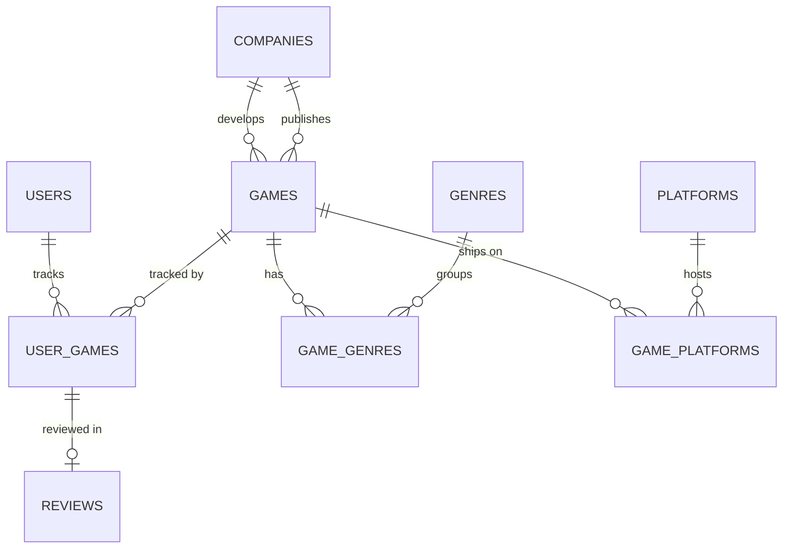

# database/

MySQL schema, seed data and tooling for Geekbond. MySQL 8.0.19+ is required, with InnoDB, utf8mb4 and strict `sql_mode` (see [ADR-0001](../docs/adr/0001-database-and-data-access-layer.md)).

```
database/
├── migrations/
│   ├── 001_init.sql            users, games, genres, game_genres, user_games, view game_stats
│   └── 002_normalization.sql   companies, platforms, game_platforms, reviews, account columns,
│                               views game_catalog and game_stats (+ review_count)
├── seeds/
│   ├── 001_seed.sql            15 demo games from the frontend mocks + the demo user's library
│   ├── 002_rawg_games.sql      real games from RAWG (generated by import-rawg.ts, see below)
│   └── 003_demo_reviews.sql    3 more demo users, their scores and written reviews
├── queries.sql                 example queries for the demo and the backend (read-only)
├── cli.ts                      npm run db:status | db:migrate | db:seed
├── import-rawg.ts              npm run db:import-rawg: downloads games from RAWG into seeds/002
└── rawg.ts                     maps RAWG's API data to our tables (pure, unit-tested)
```

## Shared group database

> **Teammates:** start with [TEAM_README.md](TEAM_README.md). It covers what was built, how to connect to our database `G1`, and what each person needs to do.

The course gives each group **one shared database** on the class MySQL server. Its name is the group name, or the group name followed by `-01`. Every teammate points at that same database, so data one person adds is visible to everyone.

1. Copy `backend/.env.example` to `backend/.env` and fill in the class server's host, your own MySQL username and password, and the group database name:

   ```
   DB_HOST=<class server host>
   DB_PORT=3306
   DB_USER=<your username>
   DB_PASSWORD=<your password>
   DB_NAME=<group name or group name-01>
   ```

   `backend/.env` is git-ignored. Never commit it, and never put passwords in any other file.

   Not sure of the exact database name? Leave `DB_NAME` empty and run `npm run db:status`: it lists every database your account can open.

2. Check the connection. This answers the instructor's three checks: you can reach the database, and its name is the group database. Every teammate should see the same name and the same row counts.

   ```bash
   npm run db:status
   ```

3. **One person** (the database architect) applies the schema and the data. Running it again is safe: `db:migrate` records each applied migration in `schema_migrations` and skips it next time, and the seeds update rows instead of duplicating them.

   ```bash
   npm run db:migrate
   npm run db:seed
   ```

   If the group database already had `001_init.sql` applied by hand, `db:migrate` notices the existing tables, records 001 as applied, and only runs 002.

4. Everyone else runs only `npm run db:status` to confirm they see the same database. The API (`npm run api`) reads the same `backend/.env`, so it uses the shared database too.

MySQL can't undo schema changes (DDL) halfway through a file. If a migration fails on the shared database, stop and tell the team before anyone runs it again. Run `npm test` against a local MySQL first: the database tests apply every migration to a throwaway database.

## Real game data from RAWG

The catalog can be filled with real games from the [RAWG Video Games Database API](https://rawg.io/apidocs):

1. Create a free account at <https://rawg.io/apidocs> and copy your API key into `backend/.env` as `RAWG_API_KEY=...`. The key stays on your machine. It is never written into the seed.
2. Generate the seed. This defaults to the 100 games most added on RAWG; `--count` takes 1 to 1000:

   ```bash
   npm run db:import-rawg -- --count 150
   ```

   Games that our schema can't hold are skipped, and the script lists why: no release date, no developer, or not on PC, PlayStation 5, Xbox Series X or Nintendo Switch.
3. Commit `seeds/002_rawg_games.sql` so teammates get the same data, then load it with `npm run db:seed`.

RAWG's terms require crediting RAWG as the source with a link to rawg.io wherever the data is shown, so the frontend footer or about page needs a "Data from RAWG" link.

What gets imported: the title, developer and publisher (into `companies`), the release year, genres, every platform (into `game_platforms`), the cover image, the description and the achievement count. RAWG has no install size, so `storage_gb` stays `NULL`. Games that are already in the database (same slug, for example `elden-ring`) are updated in place, so users' library rows keep working.

## Data model and normalization



| Table | Key | Holds |
|-------|-----|-------|
| `users` | `id` | Account: `username` and `email` (both unique), `password_hash` |
| `companies` | `id` | Each developer or publisher, stored once by `name` |
| `games` | `id` (slug) | Catalog facts about one game; `developer_id` and `publisher_id` → `companies` |
| `genres`, `platforms` | `id` | Lookup lists, unique `name` |
| `game_genres`, `game_platforms` | (`game_id`, other id) | Many-to-many links |
| `user_games` | (`user_id`, `game_id`) | One user's tracking of one game: status, score, hours, favorite, notes |
| `reviews` | (`user_id`, `game_id`) | Public review text; FK → `user_games`, so you can only review a game in your library |
| `game_catalog` (view) | | `games` joined to company names; this is what `GET /api/games` reads |
| `game_stats` (view) | | `average_score`, `popularity`, `review_count`, all computed, never stored |

How the design meets each normal form:

- **1NF:** every column holds one value. Genres and platforms are lists, so they live in link tables instead of comma-separated text.
- **2NF:** in the tables with composite keys (`user_games`, `reviews`, and both link tables), every non-key column depends on the whole key. A score belongs to a (user, game) pair, not to the user or the game alone.
- **3NF:** before 002, `games.developer` and `games.publisher` repeated company names as text ("CD PROJEKT RED" three times), so renaming a company meant updating many rows, and a typo could split one company into two. Migration 002 moves them into `companies` and references them by id. Average score and popularity are derived from `user_games` by the `game_stats` view instead of being stored, so they can't go stale.
- **No duplicated ratings:** a review stores only its text. The rating is the score already in the reviewer's `user_games` row, which the review's composite foreign key points at.

Two deliberate trade-offs:

- `games.format` stays in the table next to `game_platforms`. The UI shows and filters by a single format per game, and the full platform list lives in `game_platforms`. Every format is also in `game_platforms`, so the two can't disagree.
- `games.id` is a readable slug (`elden-ring`) instead of a number. It doubles as the RAWG slug, so re-importing updates the same row.

## Rules

- **Migrations are numbered `NNN_description.sql` and applied in order.** Never edit one that has been applied anywhere; add the next number instead.
- **Validation lives in the schema** (`CHECK`, `ENUM`, foreign keys), so bad data is rejected no matter which code writes it.
- **Seeds are idempotent** (`ON DUPLICATE KEY UPDATE` / `INSERT IGNORE`), so `npm run db:seed` is always safe to re-run.
- **No real personal data or credentials in this folder.** Demo emails use `example.com`. `tests/security/` fails on database files (`.sqlite`, `.db`) and on passwords.

## Apply to a local MySQL instead

```bash
mysql -u root -e "CREATE DATABASE geekbond"
DB_NAME=geekbond npm run db:migrate
DB_NAME=geekbond npm run db:seed
```

## Tests

`tests/database/` applies every migration to throwaway databases, checks the constraints the app relies on, upgrades a pre-002 database with data in it, runs every seed twice, runs `queries.sql`, loads a sample RAWG seed, and then drops the databases. The tests skip themselves when MySQL isn't reachable. Connection settings come from `DB_HOST`, `DB_PORT`, `DB_USER` and `DB_PASSWORD`.
