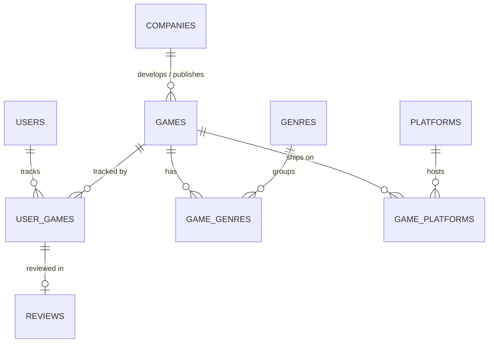

# Database: what was built and what each of us needs to do

Written by Amit (Database Architect) for the team: Andres, Mauricio and Juan.

**Short version:** our shared database **`G1`** on the class server is set up and loaded with demo data. Every teammate needs to point their own `backend/.env` at it and run one command to check access (step 1 below). After that, each person has a task to pick up in their own area (step 2).

---

## 1. Everyone: connect to the shared database (about 5 minutes)

Dr. Mohamed asked each of us to confirm three things: that we can open our group database, that we all reach the same one, and that its name matches the group name. These steps check all three.

1. **Get the code.** Pull the branch `feat/database-normalization`, or `main` once it is merged, then run `npm install`.

2. **Create your `.env` file.** Copy `backend/.env.example` to `backend/.env`, then fill it in with **your own** MySQL username and password (the course login the instructor gave you, the same one you use in MySQL Workbench):

   ```
   DB_HOST=cse335.courses.cse.louisville.edu
   DB_PORT=3306
   DB_USER=<your own MySQL username>
   DB_PASSWORD=<your own MySQL password>
   DB_NAME=G1
   PORT=3000
   DB_CONNECTION_LIMIT=1
   RAWG_API_KEY=
   ```

   `backend/.env` is git-ignored. **Never commit it, and never paste your password in the group chat or in any other file.**

3. **Check your access:**

   ```bash
   npm run db:status
   ```

   You should see `Database: G1`, both migrations checked (`[x]`), and these row counts:

   | Table | Rows |
   |-------|------|
   | games | 15 |
   | companies | 20 |
   | genres / game_genres | 32 / 62 |
   | platforms / game_platforms | 5 / 15 |
   | users | 4 |
   | user_games | 24 |
   | reviews | 7 |

   If you see those, your access works, so tell the group chat. If someone adds data later, the counts go up, and everyone still sees the same numbers.

4. **Do not run `npm run db:migrate`.** The schema is already applied. Running it again would do nothing harmful, because it skips applied migrations, but schema changes go through Amit (see section 4).

### If `db:status` fails

| Error mentions | What to do |
|----------------|------------|
| `Access denied for user` | `DB_USER` or `DB_PASSWORD` is wrong. Check them in Workbench first. |
| `Access denied ... to database 'G1'` or `Unknown database` | Leave `DB_NAME` empty and run `npm run db:status` again: it lists the databases your account can open. If `G1` isn't listed, report it to the instructor, as the announcement asked. |
| `max_user_connections` / "2 connections" | Each account allows only **2 connections at once**. Close your MySQL Workbench tabs and stop `npm run api`, then retry. |
| `ETIMEDOUT`, `ECONNREFUSED`, `ENOTFOUND` | You're off campus. Connect to the university VPN or the campus network. |

---

## 2. What each person does next

### Andres (QA & Project Manager)
- Confirm with everyone that step 1 worked, and send the instructor a note for anyone who can't open `G1`.
- Run the full check before each merge: `npm run verify`. It runs the typecheck, lint, every test and the build. The database tests need a **local** MySQL (see section 5); without one they skip themselves.
- Use `database/queries.sql` for the demo. It has 9 ready-made queries (search, top games per genre, a user's collection, reviews, recommendations), and you can paste any of them into Workbench while connected to `G1`.

### Mauricio (Backend Developer)
- The API already reads the same `backend/.env`, so `npm run api` now serves data from `G1`. Keep `DB_CONNECTION_LIMIT=1` while working on the class server.
- `GET /api/games` now reads the **`game_catalog` view** instead of the `games` table. The view returns `developer` and `publisher` as names, just like before, so the frontend didn't need changes.
- New tables ready for the endpoints in your part:
  - **Reviews:** the `reviews` table, keyed by (`user_id`, `game_id`). A user can only review a game that is in their library (`user_games`), and the body must be 1 to 5000 characters. The database rejects anything else, so return a 400 or 409 when MySQL raises a foreign key, check constraint or duplicate entry error. The star rating is the `score` in `user_games`, not a column in `reviews`.
  - **Accounts and login:** `users.email` (unique, must look like an address) and `users.password_hash`. Store only a bcrypt or argon2 hash, never the plain password.
  - **Stats:** `game_stats` (view) gives `average_score`, `popularity` and `review_count` for each game.
- Queries 5 and 8 in `database/queries.sql` are good starting points for "reviews of a game" and "recommendations".

### Juan (Frontend Developer)
- Nothing breaks: `/api/games` returns the same fields as before.
- When we switch to real game data from RAWG (section 3), RAWG's terms require a visible **"Data from RAWG"** link to <https://rawg.io> wherever the game data is shown. A footer or about page is fine.
- New fields you can show once Mauricio exposes them: written reviews, review counts, and every platform a game is on (not just the main format).

### Amit (Database Architect)
- Done: schema, normalization, migrations, seeds, the migration tool, example queries and tests, plus the setup of `G1`.
- Still to do: load real games from RAWG when its API is back up (section 3), and review any schema change anyone needs.

---

## 3. Real game data from RAWG (Amit, when RAWG is back up)

Right now `G1` has 15 demo games. To load real ones:

1. Get a free key at <https://rawg.io/apidocs> and put it in your own `backend/.env` as `RAWG_API_KEY=...`.
2. Run:
   ```bash
   npm run db:import-rawg -- --count 150
   npm run db:seed
   ```
3. Commit the generated `database/seeds/002_rawg_games.sql`, so everyone's local copy has the same data. The key is never written into that file.

Only one person needs to do this: `G1` is shared, so everyone sees the new games right away.

---

## 4. What was built

All of this is on the branch `feat/database-normalization`.

### The schema
The proposal asked for a normalized database of games, developers, genres, users, collections and reviews. Here is what is in `G1`:

| Table | What it holds |
|-------|---------------|
| `users` | Accounts: username, email, password hash |
| `companies` | Every developer and publisher, stored once |
| `games` | The catalog; `developer_id` and `publisher_id` point to `companies` |
| `genres`, `game_genres` | Genres, and which games have which (many-to-many) |
| `platforms`, `game_platforms` | Platforms, and which games are on which (many-to-many) |
| `user_games` | A user's collection: status, score, hours played, favorite, notes |
| `reviews` | A user's written review of a game in their collection |
| `game_catalog` (view) | Games with the developer and publisher names joined in; the API reads this |
| `game_stats` (view) | Average score, popularity and review count, calculated live |
| `schema_migrations` | Bookkeeping: which migration files have been applied |



### Normalization (for the report)
- **1NF:** each column holds a single value. Lists like genres and platforms live in link tables, never as comma-separated text.
- **2NF:** in the tables with two-column keys (`user_games`, `reviews`, and the link tables), every other column depends on the whole key. A score belongs to one user *and* one game.
- **3NF:** developer and publisher used to be repeated as text in `games`. They now live once in `companies` and are referenced by id, so renaming a company is a one-row change. Average score and popularity are computed by a view instead of being stored, so they can't go out of date.
- **No duplicated ratings:** a review stores only its text. Its rating is the score already in the reviewer's `user_games` row.

Full details and the design trade-offs are in [database/README.md](README.md).

### Files

| File | What it is |
|------|------------|
| `database/migrations/001_init.sql` | The original schema (existing) |
| `database/migrations/002_normalization.sql` | New: companies, platforms, reviews, account columns, views. It also upgrades a database that already has data. |
| `database/seeds/001_seed.sql` | 15 demo games, updated for the new schema |
| `database/seeds/003_demo_reviews.sql` | New: 3 more demo users, their collections and 7 reviews |
| `database/queries.sql` | New: 9 example queries for the demo |
| `database/cli.ts` | New: `npm run db:status`, `db:migrate`, `db:seed` |
| `database/import-rawg.ts`, `database/rawg.ts` | New: download real games from RAWG and turn them into a seed file |
| `tests/database/*.test.ts` | Tests for the schema, the upgrade, constraints, seeds, queries and the RAWG mapping |

### Commands

| Command | Who runs it | What it does |
|---------|-------------|--------------|
| `npm run db:status` | Everyone | Shows the server, user and database you're connected to, the migrations applied, and the row counts |
| `npm run db:seed` | Anyone | Reloads the demo data. Safe to re-run: it updates rows and never duplicates them. |
| `npm run db:migrate` | Amit | Applies new migration files |
| `npm run db:import-rawg` | Amit | Downloads real games from RAWG into a seed file |

---

## 5. Rules for working with a shared database

- **`G1` is shared.** Anything you insert, update or delete there, everyone sees. Test risky changes on a local MySQL first:
  ```bash
  mysql -u root -e "CREATE DATABASE geekbond"
  DB_NAME=geekbond npm run db:migrate
  DB_NAME=geekbond npm run db:seed
  ```
- **Schema changes go in a new migration file** (`003_something.sql`), never as edits to `001` or `002` and never typed by hand into Workbench. Message Amit first, so two people don't change the same tables.
- **If a migration fails part-way, stop and tell the group.** MySQL can't undo schema changes halfway through a file, so retrying blindly can make things worse.
- **2 connections per account:** Workbench and `npm run api` each use one. Close what you're not using.
- **No real passwords or personal data** in any committed file. Demo users use `@example.com` emails, and the tests fail if a real email or password appears.
