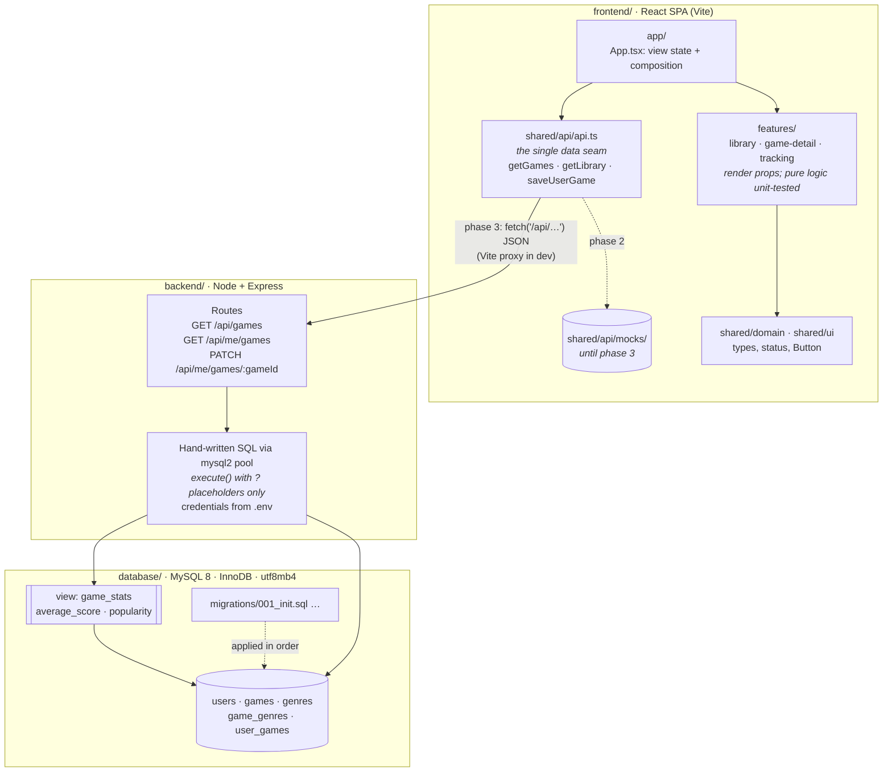
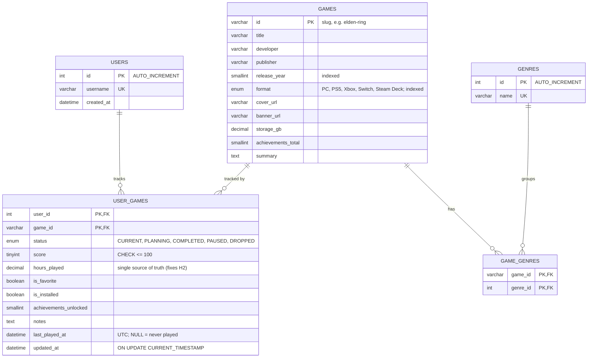
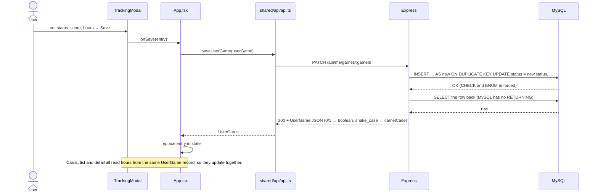

# Geekbond Target Architecture

Target state after phase 3 of the [architecture review](architecture-review.md) roadmap. Decisions behind it: [ADR-0001](adr/0001-database-and-data-access-layer.md).

## 1. Repository layout

The repository is split into independent modules. Each one has a README with its own rules.

```
/
├── frontend/                  React SPA (Vite)
│   ├── index.html
│   ├── public/
│   └── src/
│       ├── main.tsx
│       ├── app/               composition root: App, TopBar, PixelWaves
│       ├── features/          one folder per feature, public API in index.ts
│       │   ├── library/       Sidebar, FilterBar, GameGrid, GameListView, MediaCard, filters, collections
│       │   ├── game-detail/   MediaHero
│       │   └── tracking/      TrackingModal
│       └── shared/            used by everything, depends on nothing above it
│           ├── api/           api.ts (the data seam) + mocks/ (until phase 3)
│           ├── domain/        game.ts (types), status.ts
│           └── ui/            Button, GeekbondLogo
├── backend/                   Express + mysql2 API (phase 3)
├── database/
│   └── migrations/            001_init.sql, 002_…
├── tests/                     frontend/ · database/ · backend/ · architecture/ · security/
├── docs/                      architecture, ADRs, review
└── package.json, tsconfig*.json, vite/tailwind/postcss configs (shared, repo root)
```

### Module rules (enforced by `tests/architecture/`)

| Rule | Why |
|------|-----|
| `shared/` never imports `app/` or `features/` | Shared code stays reusable, and there are no import cycles |
| A feature never imports another feature | Features can be changed, or removed, independently |
| Outside a feature, import only its `index.ts` | Each feature's internals can be refactored freely |
| Only `app/` calls `shared/api/api.ts` | Data enters in one place; features get data through props |
| Only `api.ts` touches `shared/api/mocks/` | Swapping mocks for the real API changes one file |
| `frontend/` never imports `backend/` or `database/`, and vice versa | The only link between them is the HTTP contract |

Adding a feature means creating `features/<name>/` with an `index.ts`, then composing it in `app/App.tsx`.

## 2. System layers

Each layer may only call the layer directly below it. `api.ts` is the only place where the UI touches data.



## 3. Data model



`average_score` and `popularity` are not stored. The `game_stats` view computes them from `user_games`.

## 4. Example flow: saving a tracking entry



On error (for example, a score above 100 rejected by the CHECK constraint, MySQL error 3819), the API returns 400, `api.ts` throws, and the modal stays open showing the message. No data is lost.
