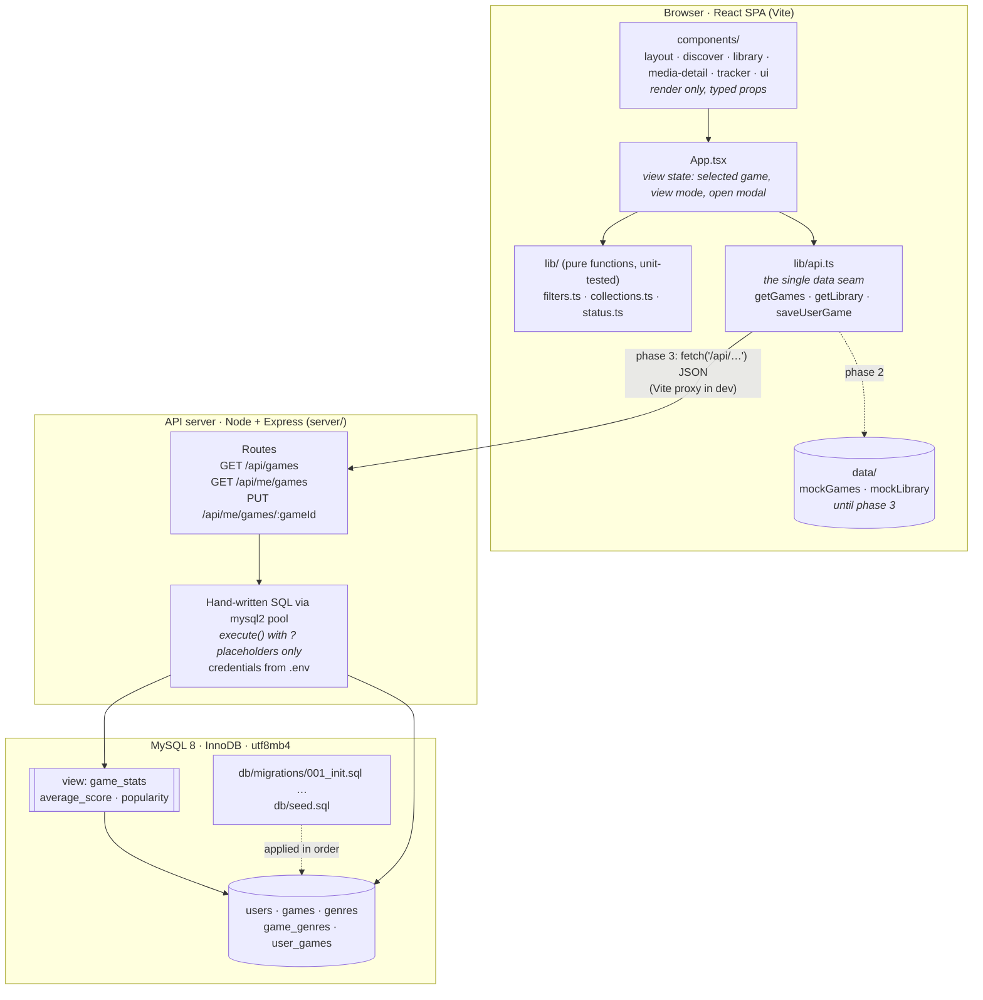
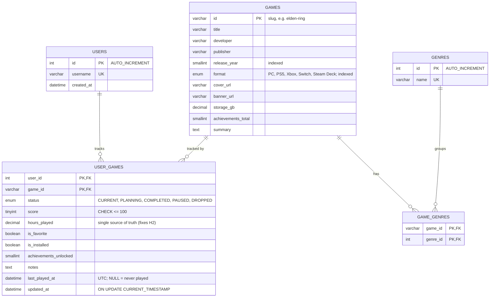
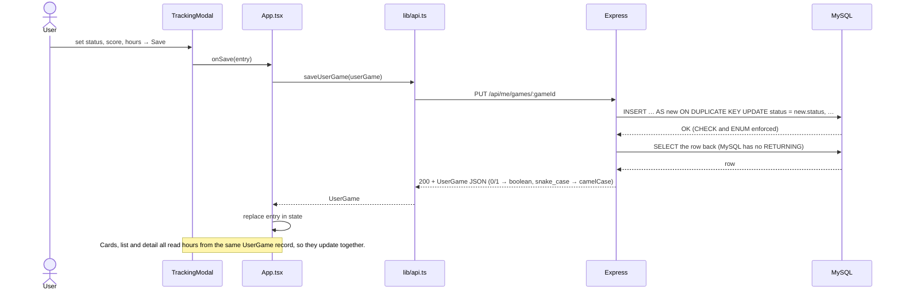

# Geekbond Target Architecture

Target state after phase 3 of the [architecture review](architecture-review.md) roadmap. Decisions behind it: [ADR-0001](adr/0001-database-and-data-access-layer.md).

## 1. System layers

Each layer may only call the layer directly below it. The arrow from `api.ts` is the only place where the UI touches data, so swapping mocks for the real API changes one file.

**Dependency rules**
- `components/` never import from `data/` or `api.ts`. They get everything through props.
- `lib/` has no React and no I/O, so it can be tested in isolation.
- Only `server/` knows SQL, and only `db/migrations/` changes the schema.

## 2. Data model

`average_score` and `popularity` are not stored. The `game_stats` view computes them from `user_games`.

## 3. Example flow: saving a tracking entry

On error (for example, a score above 100 rejected by the CHECK constraint, MySQL error 3819), the API returns 400, `api.ts` throws, and the modal stays open showing the message. No data is lost.
